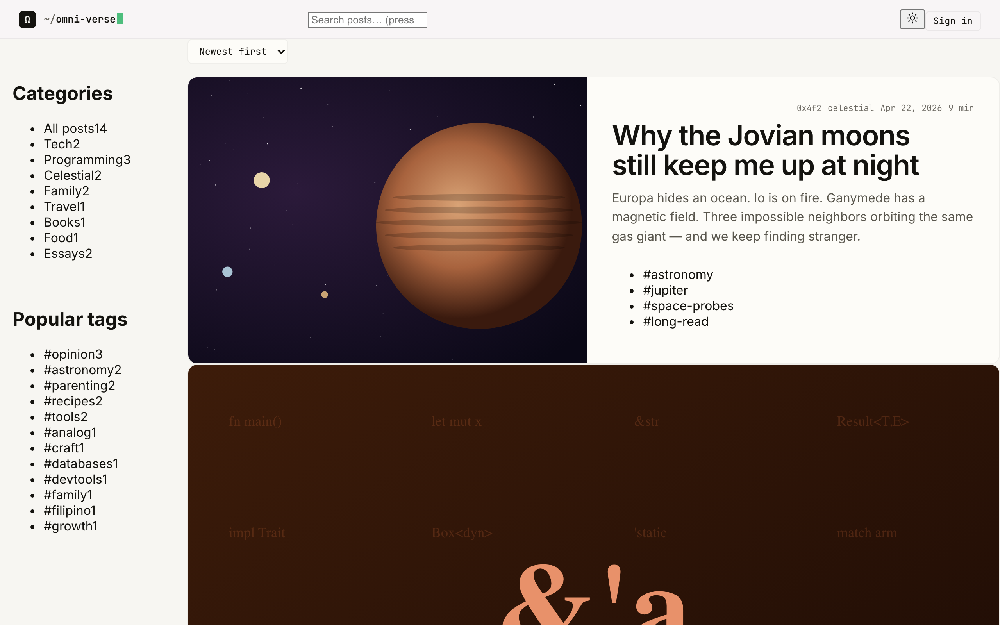
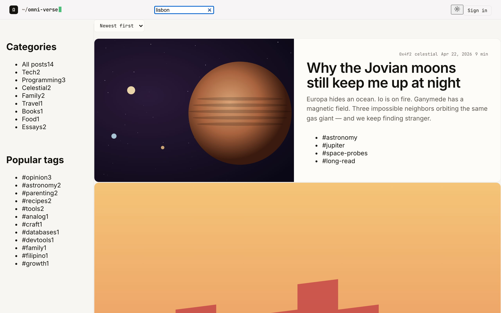
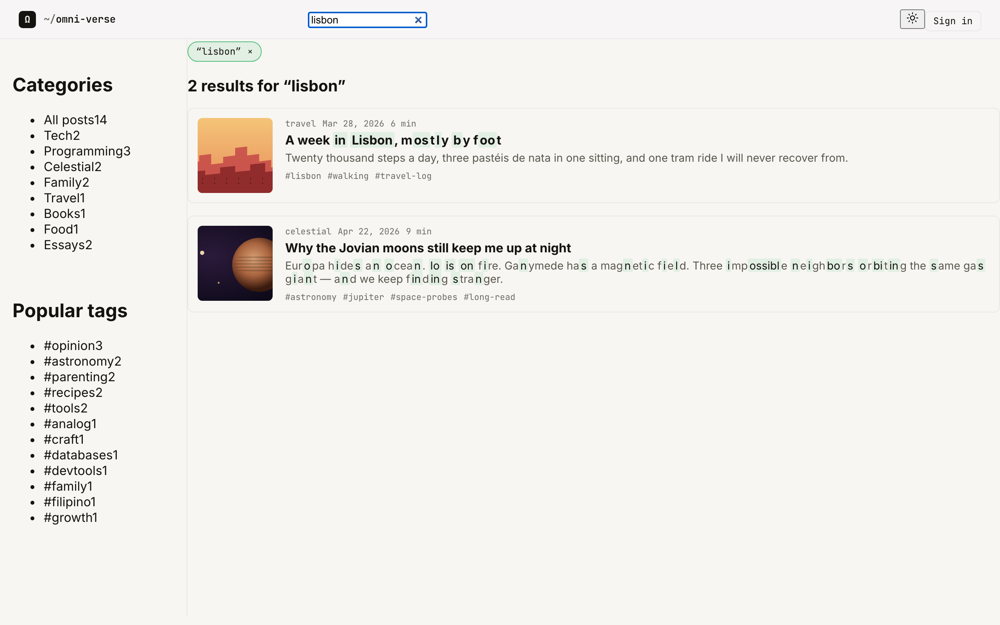
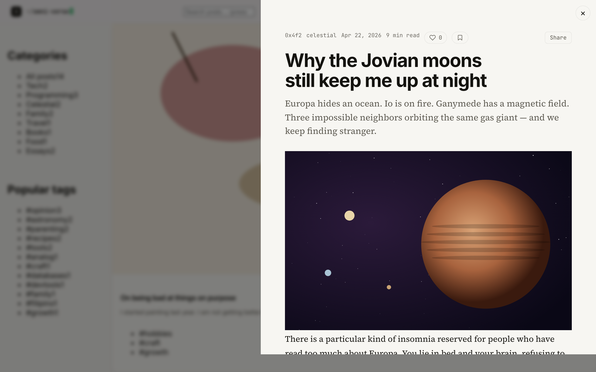
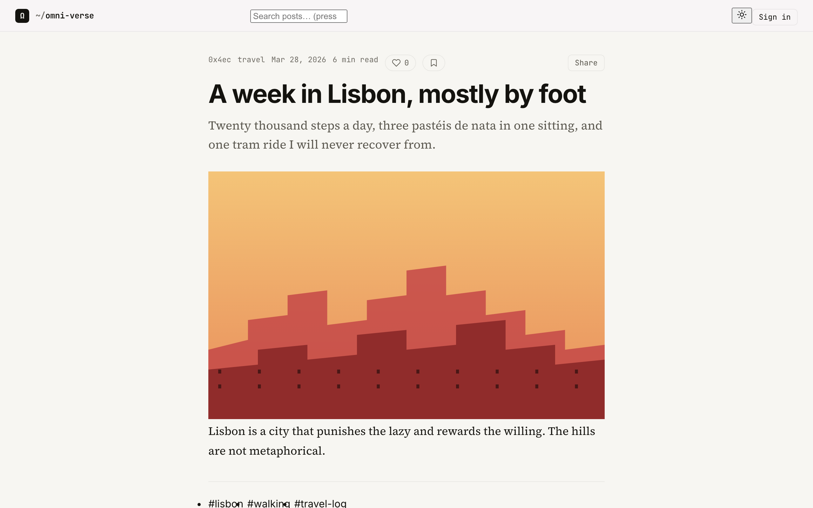
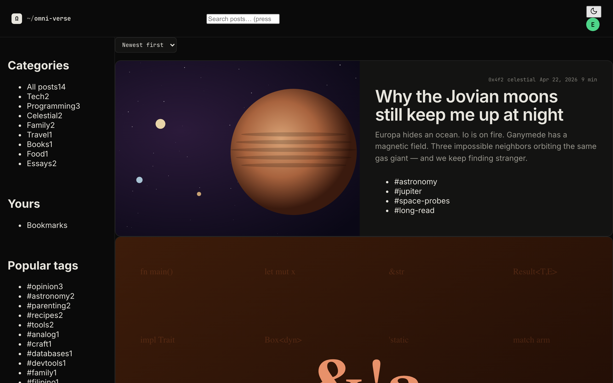
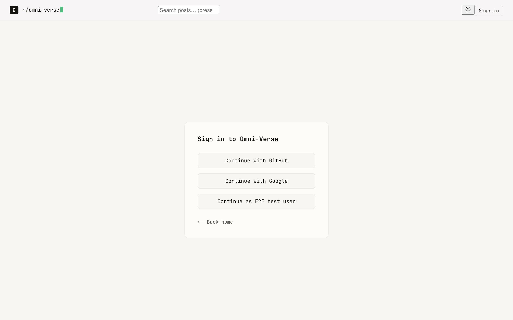
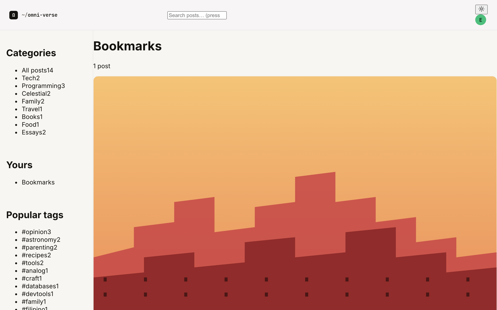
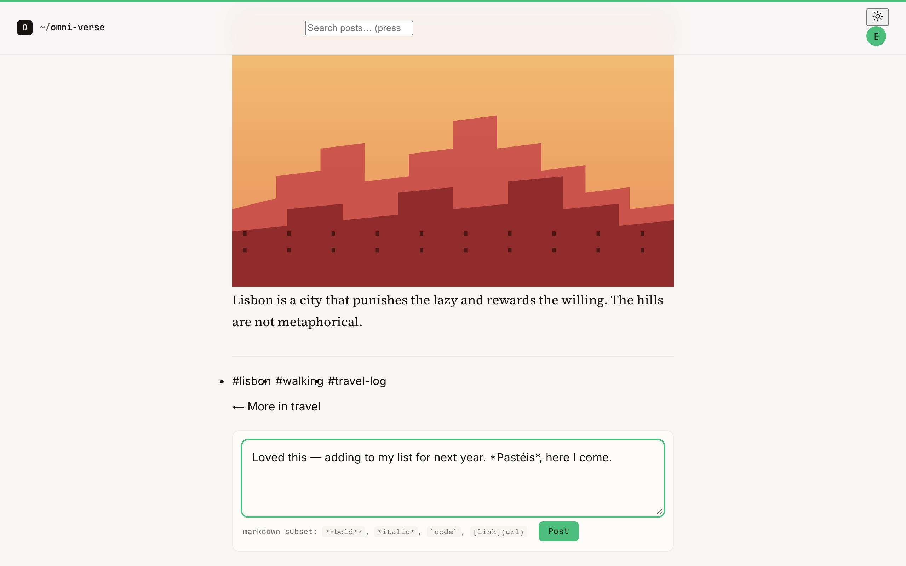
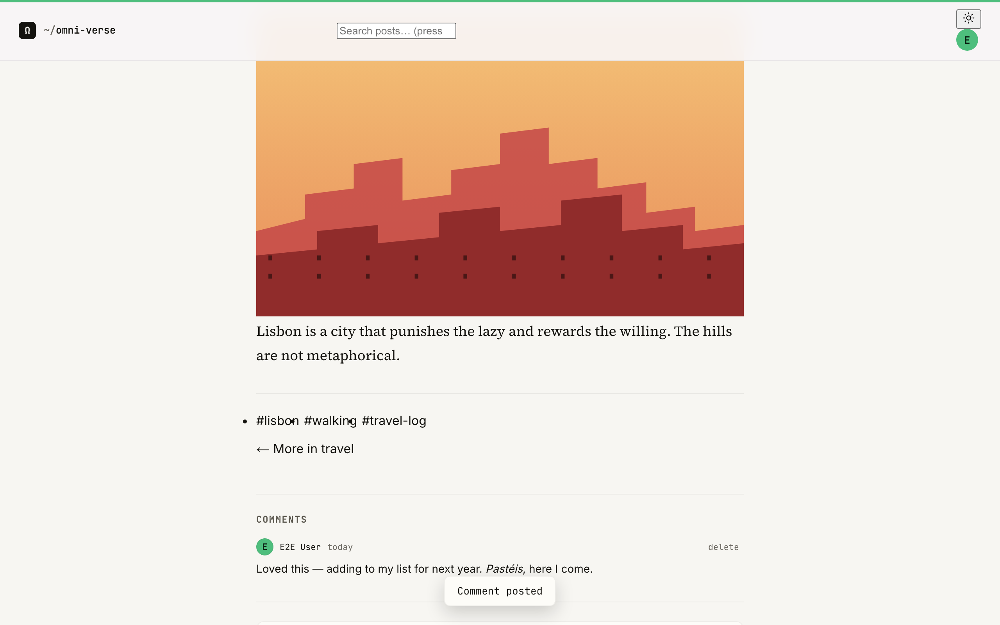

# Reader's guide

A walkthrough of the Omni-Verse Blog from a visitor's perspective. Everything below is anonymous-friendly except the bookmark and comment flows, which prompt you to sign in.

## The home grid

The home page is a magazine layout. The hero card up top is whatever the latest post happens to be. The rest of the grid is sized per post — `hero`, `wide`, `medium`, `small` — to break up the rhythm.

The left sidebar shows category counts and the popular tags cloud. Both are derived at build time from the actual `content/posts/*.mdx` files. Click any to filter the grid down to that slice.

The topbar has three controls:

- **The brand** (`Ω ~/omni-verse`) — always returns you home.
- **The search box** (or hit <kbd>/</kbd> from anywhere) — see [search](#search).
- **The theme toggle** + sign-in button — see [dark mode](#dark-mode) and [sign in](#sign-in).

## Sort

Above the grid, a "Newest first" / "Oldest first" dropdown re-sorts the visible posts. The selection persists for the page; reload returns to "Newest first".

## Search

Two ways to search.

**Live filter.** Start typing in the topbar searchbox while you're on the home page (or any list page). The grid filters in place — no navigation, no page reload. The query updates as you type.

**Full results page.** Press <kbd>Enter</kbd> from the searchbox to navigate to `/search?q=<your query>` — a dedicated page that scores results (title hits beat tag hits beat body hits) using fuse.js against a build-time index. URLs are shareable.

Press <kbd>/</kbd> from anywhere to focus the search box. <kbd>Esc</kbd> clears it.

## Opening a post

Click any post card and the article opens in a **drawer** — a real `<dialog>` element that slides in from the right with a backdrop. The home grid stays in place behind it; press <kbd>Esc</kbd> or click the backdrop to close. The URL updates to `/posts/<slug>`, and the back button closes the drawer cleanly.

The drawer is more than a modal. The article content inside is rendered server-side (parallel slot + intercepting route in Next.js terms) so it's fully indexable, has its own metadata, and works with view-source.

If you visit `/posts/<slug>` directly (or refresh while the drawer is open), you get the **full article page** — same content, no backdrop, with related posts and the comments below.

While reading, a thin progress bar at the top of the page tracks how far you've scrolled. It works inside the drawer too.

## Dark mode

Click the sun/moon icon in the topbar to flip themes. The choice is remembered in `localStorage` and applied before the first paint on subsequent visits, so there's no flash of the wrong theme.

If you've never picked a theme, the blog respects your OS-level preference (`prefers-color-scheme`).

If you've turned on **reduced motion** in your OS settings, the drawer fades instead of sliding, the topbar cursor stops blinking, hover lifts on cards are disabled, and smooth-scroll is turned off site-wide.

## Sign in

The blog is anonymous-friendly: you can read everything without an account. The two things that need an account are **bookmarks across devices** and **commenting**.

Click "Sign in" in the topbar (or any "Sign in to comment" / similar prompt) to land on `/signin`:

GitHub and Google are the two providers. There's no email/password and no signup flow — your account is created on first sign-in.

After signing in:
- Your avatar replaces the "Sign in" button.
- A "Yours" section appears in the sidebar with a link to `/bookmarks`.
- Comments sections show a comment form instead of a "Sign in to comment" prompt.

## Bookmarks

You can bookmark posts **before signing in** — bookmarks are stored in your browser's `localStorage`. The button is at the top of every post next to the share button.

When you eventually sign in, the blog merges your local bookmarks into your account automatically (you'll see a "Synced N bookmarks" toast). After that, bookmarks persist across devices.

The `/bookmarks` page lists all your saved posts:

Click the bookmark icon again to remove a bookmark.

## Comments

Comment forms appear at the bottom of every full post page when you're signed in. They support a small markdown subset: `**bold**`, `*italic*`, `` `code` ``, and `[link text](https://example.com)`. The help text below the textarea reminds you of the syntax.

Click "Post" — a "Comment posted" toast confirms, and your comment appears in the list below:

Each of your comments has a `delete` button. Deletion is soft (the comment is hidden, not erased) and there's a confirmation dialog. Other people's comments are read-only.

Comments use a tiny rate limit (one per 30 seconds per user) and a 4000-character cap.

## Feeds

The blog publishes the latest 30 posts as Atom at `/feed.xml`. Most feed readers — NetNewsWire, Reeder, Inoreader — auto-detect it via the `<link rel="alternate">` tag in the homepage `<head>`.

For sitemaps and SEO crawlers, `/sitemap.xml` and `/robots.txt` are also live.

## Keyboard shortcuts

| Key | Action |
|---|---|
| <kbd>/</kbd> | Focus the search box (from anywhere) |
| <kbd>Esc</kbd> | Clear the search box / close the drawer |
| <kbd>Tab</kbd> / <kbd>Shift</kbd>+<kbd>Tab</kbd> | Cycle focus through interactive elements; a "Skip to content" link is the first stop |
| <kbd>Enter</kbd> in the search box | Navigate to `/search?q=…` |

That's the whole reader surface. The author's side of things is in [author.md](./author.md).
